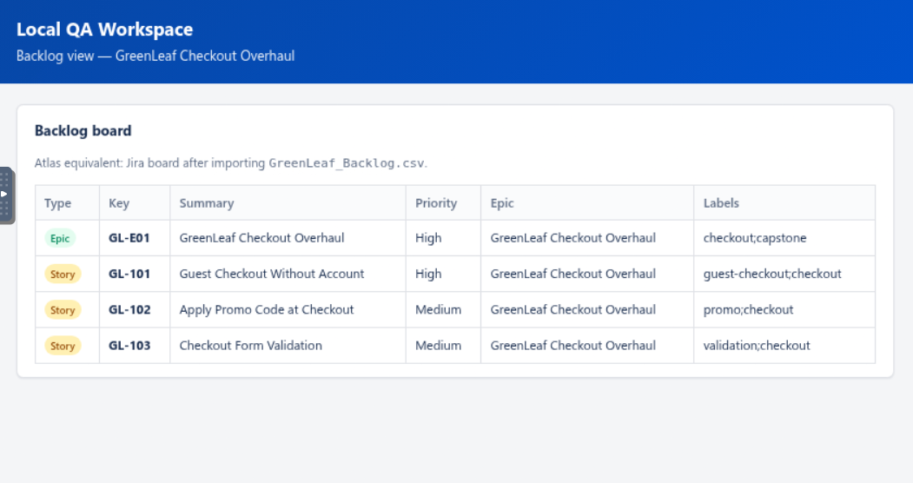
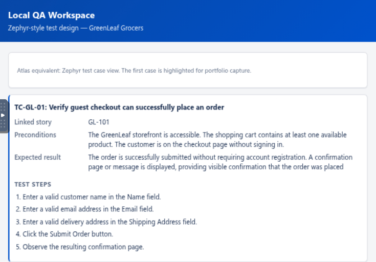
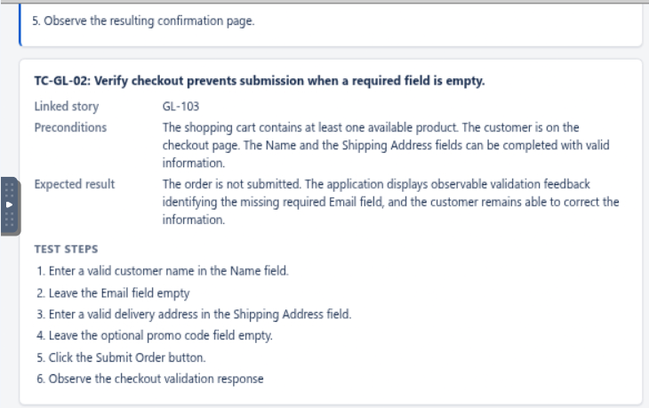
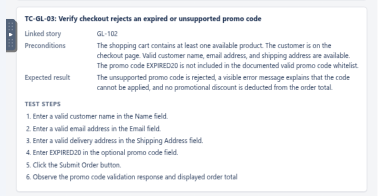
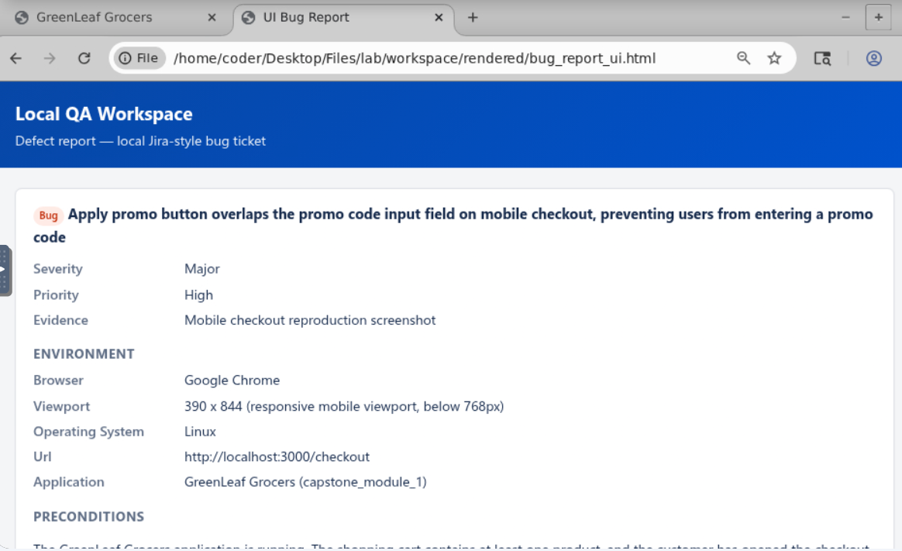
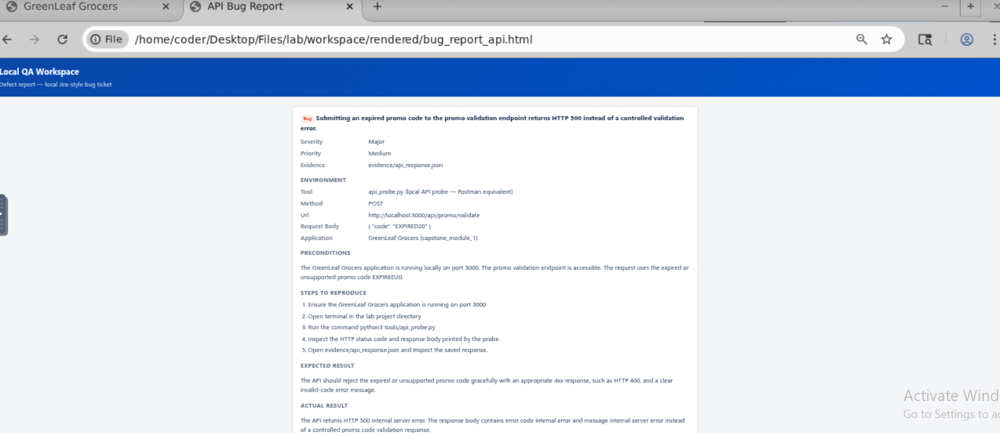
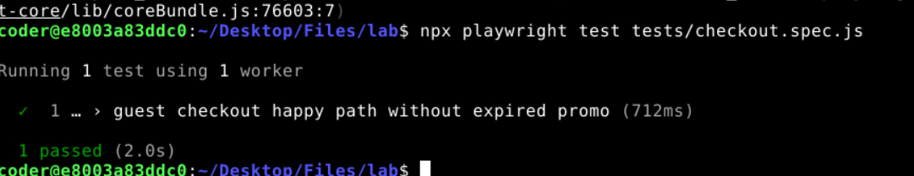
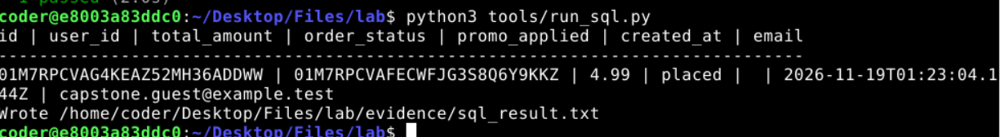
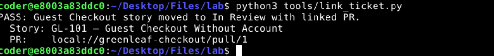

# GreenLeaf Grocers: Checkout QA

End-to-end QA of a checkout overhaul for a practice grocery web app: test design, defect reporting, Playwright automation, SQL backend validation and a release recommendation.

> **Context:** guided capstone exercise on a practice application. Jira and Zephyr views are local equivalents and the pull request is a local record (`local://`).

## Result

**Release recommendation: No-Go.** The guest checkout happy path passes (Playwright + SQL), but two defects found in testing were still open: one blocks promo entry on mobile and one is an uncontrolled server error in promo validation.

## Scope

Epic **GL-E01 GreenLeaf Checkout Overhaul**

| Story | Summary | Test case |
| --- | --- | --- |
| GL-101 | Guest checkout without account | TC-GL-01: guest checkout places an order |
| GL-102 | Apply promo code at checkout | TC-GL-03: expired or unsupported promo code is rejected |
| GL-103 | Checkout form validation | TC-GL-02: submission blocked when a required field is empty |

## Test design

Three test cases written in Zephyr style, each linked to its story for traceability.

## Defects

| Defect | Where | Expected | Actual |
| --- | --- | --- | --- |
| **Apply Promo button overlaps the promo code input** | Mobile checkout, 390 x 844 viewport, Chrome | Input and button shown separately; user can enter a code | Button overlaps the input and blocks entry |
| **Promo API returns HTTP 500** | `POST /api/promo/validate` with code `EXPIRED20` | HTTP 400 with a clear invalid-code message | HTTP 500 `internal_error` |

Each report includes environment, preconditions, steps to reproduce, expected and actual results, and captured evidence.

## Automation (Playwright, JavaScript)

`tests/checkout.spec.js` automates the guest checkout happy path: add a product, complete checkout, and verify the confirmation page and order ID.

## Backend validation (SQL)

[`queries/order_validation.sql`](queries/order_validation.sql) confirms the order persisted for the test guest: status `placed`, total `4.99`, no promo applied.

## Traceability

The change was linked to story GL-101 through a pull request, and the story moved to **In Review**.

## Full report

[End-to-End Release Portfolio (PDF)](docs/End-to-End_Release_Portfolio.pdf)

## What I would do next

- Add negative and boundary tests for the promo flow.
- Automate the mobile viewport check for the promo button.
- Add a Playwright test that asserts the promo API returns 400 once the defect is fixed.
